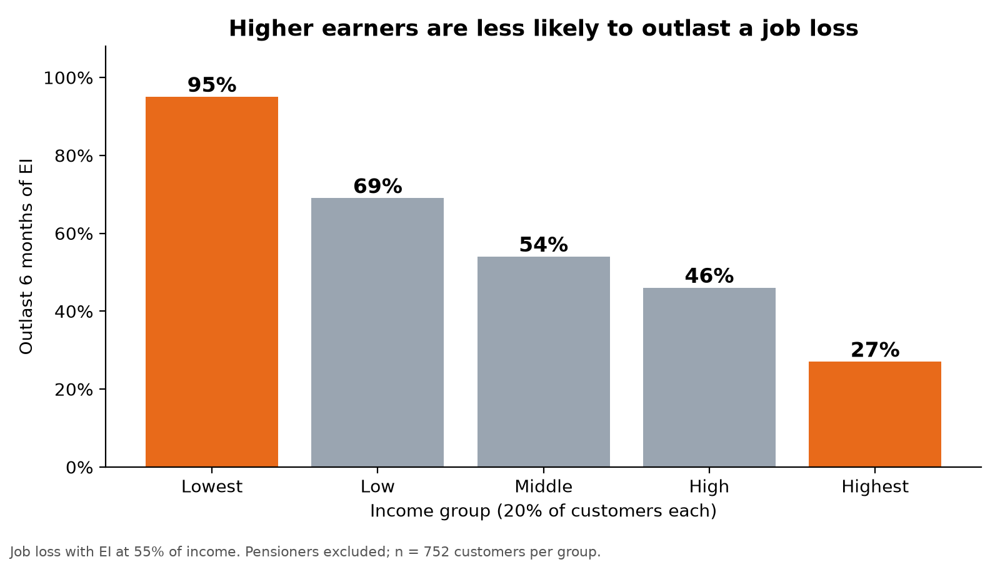

# Resilience Rewired: Financial Resilience Engine

**Tangerine Track · Sheridan Datathon 2026**

Enter any `account_id` and the engine shows the customer's income, fixed costs, spending, savings buffer and months of runway. Apply a shock (job loss with EI, higher household bills, a surprise repair, or a mix), adjust its size, and get a goal plan and a backup plan based on that customer's own numbers.

## Biggest finding: the highest earners are the least prepared

We expected low-income customers to be the most vulnerable to a job loss. The data says the opposite.

We ran the engine on all 4,500 accounts with a job-loss shock (income drops to 55% under EI) and asked: **who can outlast six months of EI?**

| Income group (20% each) | Median monthly income | Buffer, in months of spending | Outlast 6 months of EI |
|---|---|---|---|
| Lowest | 2,000 | 8.9 | **95%** |
| Low | 5,387 | 4.0 | 69% |
| Middle | 9,468 | 2.8 | 54% |
| High | 13,260 | 2.4 | 46% |
| Highest | 21,634 | 1.7 | **27%** |

*752 customers per group; pensioners excluded.*



**Why it happens.** 

Higher earners spend more and keep less in savings relative to what they spend. The top earners hold a median of just 1.7 months of spending in the bank. When income falls by 45%, their costs don't fall with it, so their savings run out fast.

**How we checked it.**
- **Pensioners:** 66% of the "low" income group are pensioners, whose income wouldn't stop with a job loss. Removing all 740 pensioners, the pattern holds (27% vs 95%).
- **Fairer job-loss rule:** re-running the shock so pension income is not cut gives the same result.
- **Sample size:** every group has 752 customers, so this is not driven by a handful of accounts.

**What a bank could do.** Financial-wellness support usually targets low-income customers. Our results suggest high earners with thin buffers are a large, overlooked at-risk group. A bank could run this runway stress test on every customer and offer emergency-fund tools based on months of buffer, not income.

## Other findings

1. **Job loss is the shock that matters.** 35% of customers would run out of savings before EI ends. A 15% rise in household bills pushes only 3% under six months, partly because 27% of accounts pay no household bills through the bank.
2. **The engine flags future defaults before the loan is granted.** Using only pre-loan data, customers with under 3 months of job-loss runway later defaulted at 22%, versus 4% for those with 6 to 12 months (615 loans).
3. **Any overdraft before the loan was a red flag.** All 27 customers who went below zero before their loan later defaulted; none of the 606 who never went below zero did. This is a perfect split in this dataset, so we treat it as a strong signal, not a guaranteed rule.
4. **Local unemployment barely matters.** District unemployment and customer resilience are almost unrelated (correlation −0.06).

## How to run

```bash
pip install -r requirements.txt
```

Put the competition's `data/` folder in the project root (it is not included in this repo).

**Dashboard**

```bash
python build_metrics.py
streamlit run app.py
```

**Analysis (reproduces the findings and charts)**, run from the project root:

```bash
python analysis/build_customer_table.py   # one row per customer -> analysis/output/customer_table.csv
python analysis/findings.py               # findings tables + charts -> analysis/output/charts/
python analysis/checks.py                 # robustness checks + headline chart
```

## Project structure

| File | What it does |
|---|---|
| `app.py` | Streamlit dashboard: customer profile, shock sliders, goal and backup plans |
| `engine.py` | Runway and shock calculations, shared by the dashboard and the analysis |
| `build_metrics.py` | Prepares per-customer metrics for the dashboard |
| `paths.py` | File locations |
| `analysis/build_customer_table.py` | Builds the one-row-per-customer table for all 4,500 accounts under five standard shocks (uses `engine.py`) |
| `analysis/findings.py` | Six analyses: default vs runway, EI survival, income, shock comparison, region, demographics |
| `analysis/checks.py` | Robustness checks (pensioners, overdraft timing, pre-loan runway) and the headline chart |
| `analysis/output/charts/` | All charts used in this README and our demo |

## Definitions

We use the provided definitions from the track brief, computed from `monthly_summary.csv` and `loans.csv`:

| | Definition |
|---|---|
| I | Median of `money_in` |
| F | Median of the monthly total of `household_bills + insurance + loan_payments` (shown on the profile, not used in runway) |
| S | Median of `money_out` |
| B | Mean of `avg_daily_balance` over the account's last 6 rows, sorted by month |
| H | Median of `household_bills` |
| P | `monthly_payment` from `loans.csv` if the loan is still running at the end of 2025 (status C or D), otherwise 0 |

```
buffer_left = B - one_off_costs
gap         = spending_after_shock - income_after_shock
runway      = 0                       if buffer_left <= 0
              "no shortfall (120+)"   if gap <= 0
              min(buffer_left / gap, 120), rounded to 1 decimal
```

The dashboard and the analysis both use the same runway code in `engine.py`, so every number in our findings matches what the dashboard shows.

## Limitations

- Income is based on monthly medians, which can misrepresent customers with irregular cash income.
- Some groups (for example, very short runways) are small; we report group sizes alongside every rate.
- These are correlations, not proof of cause and effect.
- Amounts are in the dataset's original currency, not Canadian dollars.

## Data and sources

- PKDD'99 Discovery Challenge Financial dataset (real anonymized bank data), CTU Prague Relational Dataset Repository: https://relational.fel.cvut.cz/dataset/Financial
- Employment Insurance regular benefits, Government of Canada: https://www.canada.ca/en/services/benefits/ei/ei-regular-benefit.html
